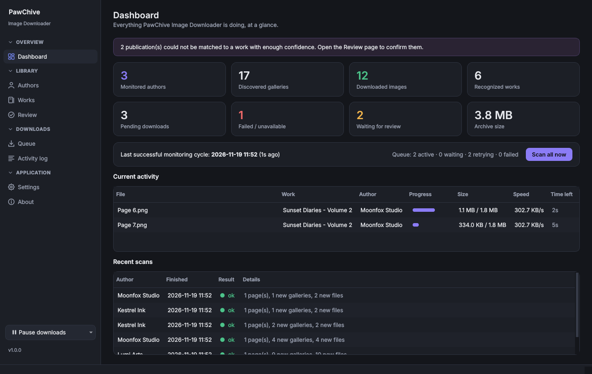
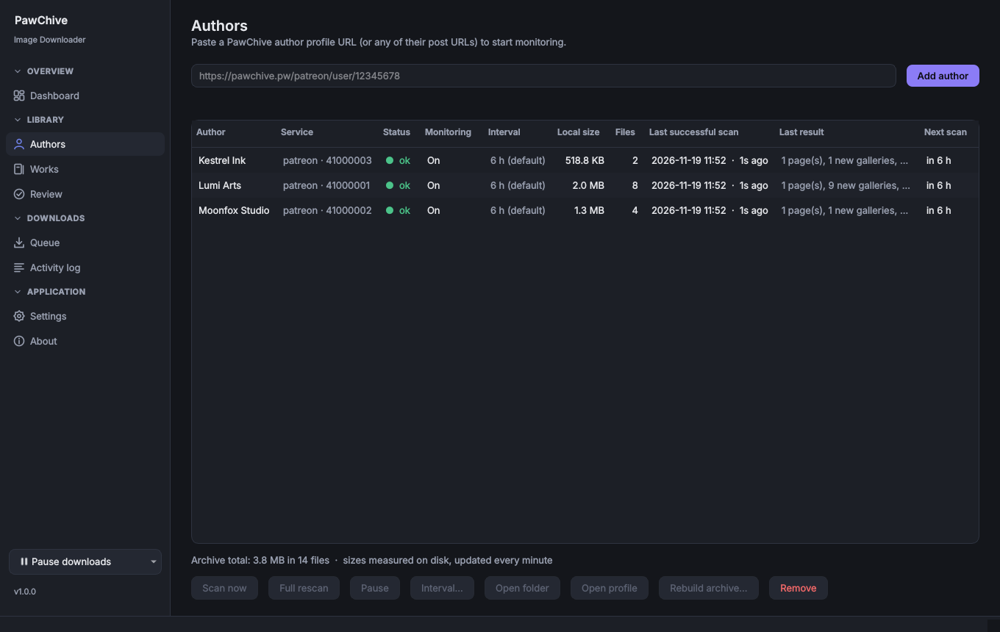
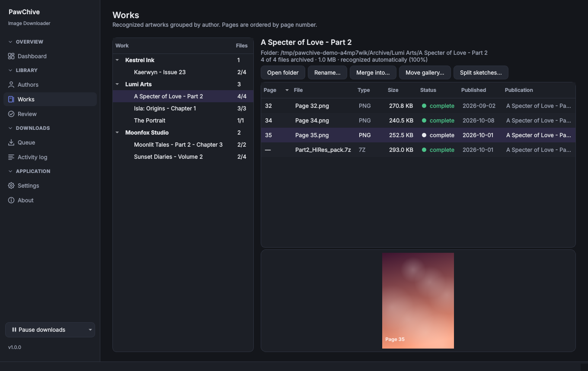
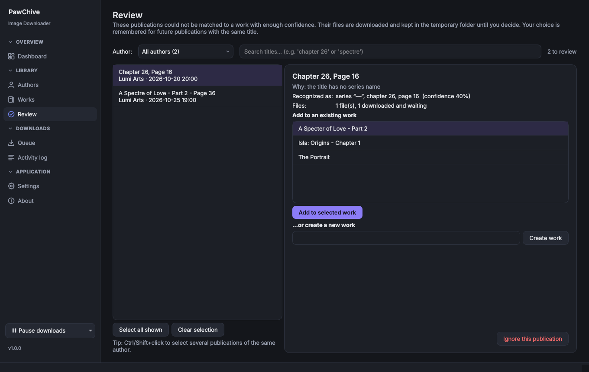
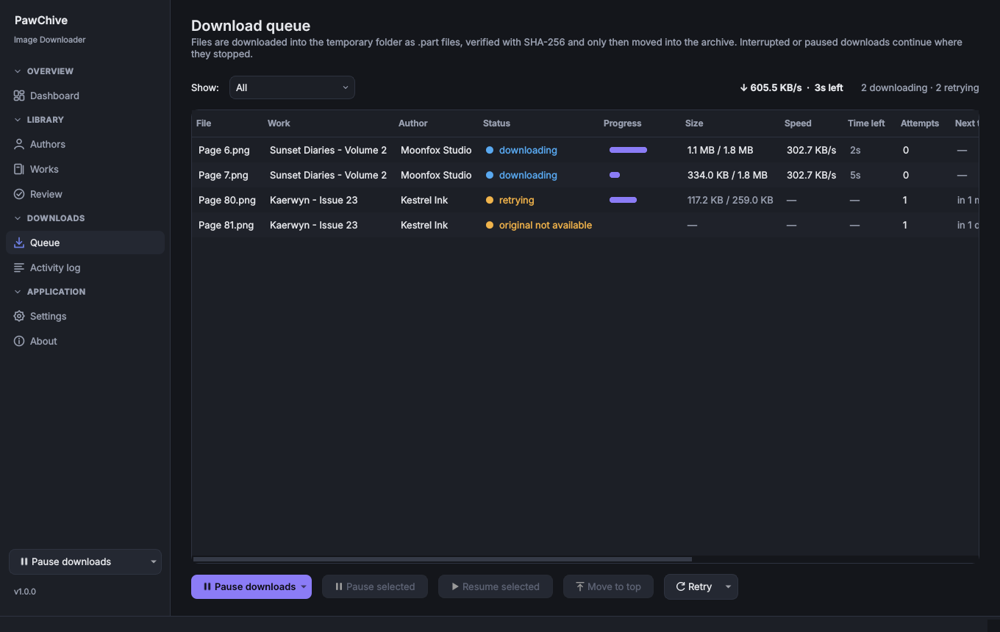
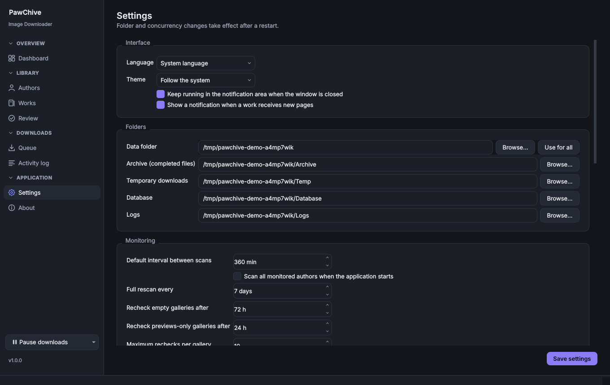
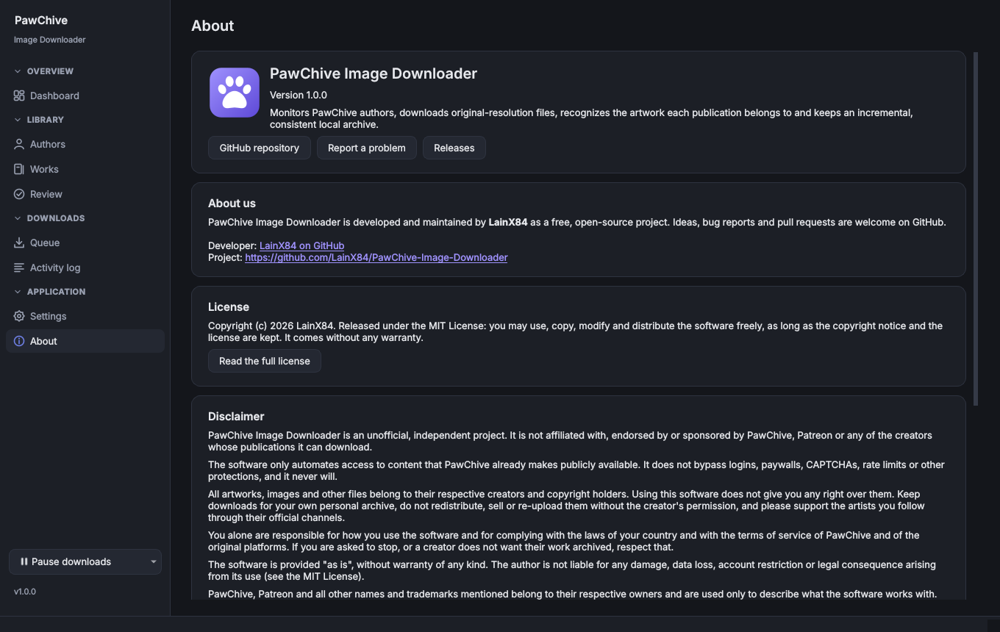
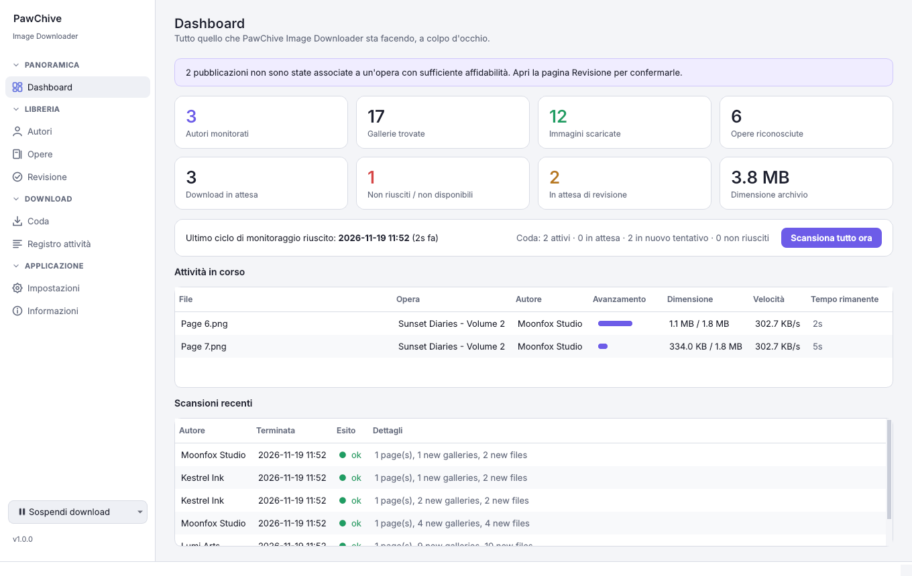
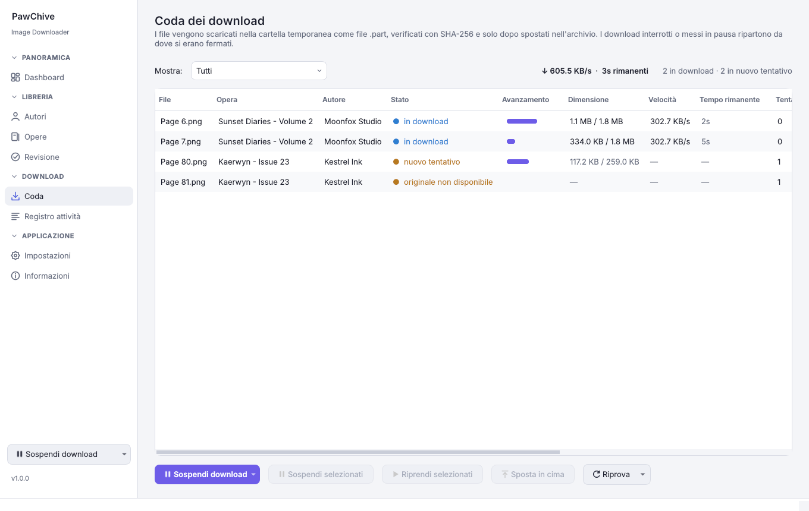

<p align="center">
  
</p>

<h1 align="center">PawChive Image Downloader</h1>

<p align="center">
  Monitor PawChive authors and keep a clean, incremental archive of their original-resolution publications.
  <br>
  <a href="https://github.com/LainX84/PawChive-Image-Downloader/releases/latest"><b>Download</b></a> ·
  <a href="#features">Features</a> ·
  <a href="#installation">Installation</a> ·
  <a href="DISCLAIMER.md">Disclaimer</a> ·
  <a href="CHANGELOG.md">Changelog</a>
</p>

<p align="center">
  <a href="https://github.com/LainX84/PawChive-Image-Downloader/actions/workflows/ci.yml"></a>
  <a href="https://github.com/LainX84/PawChive-Image-Downloader/releases/latest"></a>
  <a href="LICENSE"></a>
  
</p>

A desktop application for **Windows, Linux and macOS** that **monitors PawChive authors**: it downloads
the **original-resolution files**, recognizes **which artwork or series** each publication belongs to
and files every page in the right folder, in the right order.

It is not a one-shot gallery downloader. Add an author once; from then on new publications are
detected, verified and archived automatically — and you get a notification when a work receives new
pages.



> **Please read the [disclaimer](DISCLAIMER.md).** This is an unofficial project, not affiliated with
> PawChive or Patreon. Every downloaded file belongs to its creator: keep it for your personal archive
> and support the artists you follow.

## Contents

- [Features](#features)
- [Screenshots](#screenshots)
- [Installation](#installation)
- [First-time setup](#first-time-setup)
- [Adding monitored authors](#adding-monitored-authors)
- [How monitoring works](#how-monitoring-works)
- [Artwork recognition](#artwork-recognition)
- [Archive structure](#archive-structure)
- [Download recovery](#download-recovery)
- [Pausing, speed limit and queue order](#pausing-speed-limit-and-queue-order)
- [Language, theme and notification area](#language-theme-and-notification-area)
- [Authentication and cookies](#authentication-and-cookies)
- [Configuration reference](#configuration-reference)
- [Troubleshooting](#troubleshooting)
- [Known limitations](#known-limitations)
- [Building from source](#building-from-source)
- [Development](#development)
- [License, disclaimer and credits](#license-disclaimer-and-credits)

## Features

- **Author monitoring** — paste a profile URL (or any post URL) and the author is watched on a
  schedule. Pause, resume, scan now, per-author intervals.
- **Original files only** — files are taken from PawChive's file servers, never from thumbnails,
  and verified against the SHA-256 that PawChive embeds in every file path.
- **Artwork recognition** — titles such as `A Specter of Love - Part 2 - Page 35` or
  `Isla: Origins - Chapter 1 - Page 12` are parsed into series, part/chapter/volume/issue and page.
  New pages are added to the existing work, in page order, even when they arrive out of order.
- **Asks when unsure** — similar but different titles are never merged automatically. Ambiguous
  publications wait in a *Review* queue; your decision is remembered for the future.
- **Extras included** — archives, videos and PDFs attached to a publication are stored with the work.
- **Empty and incomplete galleries** — text-only posts and posts whose originals are not on the
  server yet are recorded, not re-downloaded, and rechecked later.
- **Reliable downloads** — `.part` files, HTTP Range resume, integrity checks, atomic moves,
  persistent queue, exponential back-off, recovery after crashes and restarts.
- **Full control of the queue** — pause everything (also for a while or until a given time), pause
  single files, move files to the top, limit the download speed, and see the speed and the time left
  of every download.
- **Polite to the website** — throttled requests, limited concurrency, `Retry-After` honoured,
  automatic pause when access is blocked. No proxy rotation, no bypassing protections.
- **No duplicates** — every file is identified by its hash; re-posted files are not downloaded twice
  and existing files are never overwritten.
- **Comfortable** — English and Italian, light and dark theme (or follow the system), runs in the
  notification area with desktop notifications for new pages.
- **Private by default** — no account needed; optional cookies live only in the OS credential store
  and are never logged.

## Screenshots

| | |
|---|---|
|  |  |
| **Authors** — monitored authors and their scan status | **Works** — pages in order, with preview |
|  |  |
| **Review** — confirm ambiguous publications | **Queue** — speed, time left, pause and order |
|  |  |
| **Settings** — language, theme, limits | **About** — license, disclaimer, credits |
|  |  |
| **Light theme**, Italian interface | **Queue** in the light theme |

*Screenshots use invented demo data.*

## Installation

### Ready-to-use builds (recommended)

Download the file for your system from the
[latest release](https://github.com/LainX84/PawChive-Image-Downloader/releases/latest). No Python is
needed.

| System | File | How to start |
|---|---|---|
| Windows 10/11 (64-bit) | `PawChive-Image-Downloader-<version>-windows-x64.zip` | Extract the zip anywhere and run `PawChiveDownloader.exe` |
| macOS 12+ on Apple Silicon (M1–M4) | `…-macos-arm64.dmg` | Open the dmg and drag the app to *Applications* |
| macOS 12+ on Intel | `…-macos-x64.dmg` | Open the dmg and drag the app to *Applications* |
| Linux x64 (glibc 2.35+, e.g. Ubuntu 22.04, Fedora 36, Debian 12) | `…-linux-x64.tar.gz` | Extract it and run `./PawChiveDownloader` |

The builds are not code-signed (signing certificates are not free), so the first start needs one
extra click:

- **Windows** — if SmartScreen says *"Windows protected your PC"*, click **More info → Run anyway**.
- **macOS** — the first time, **right-click the app → Open → Open**. If macOS says the app "is damaged",
  run `xattr -dr com.apple.quarantine "/Applications/PawChive Image Downloader.app"` in Terminal.
- **Linux** — Qt needs a few common system libraries; if the app does not start, install them, e.g.
  `sudo apt install libxcb-cursor0 libxkbcommon-x11-0 libegl1` (Debian/Ubuntu).

Each release also lists the `SHA256SUMS.txt` of every file.

### Running from source

1. Install **Python 3.11 or newer** ([python.org](https://www.python.org/downloads/); on Windows tick
   *"Add python.exe to PATH"*).
2. Download or clone this repository and install the dependencies (about 250 MB, mostly Qt):

   ```bash
   git clone https://github.com/LainX84/PawChive-Image-Downloader.git
   cd PawChive-Image-Downloader
   python -m pip install -r requirements.txt
   ```

3. Start the application:
   - **Windows:** double-click **`PawChiveDownloader.pyw`** (it runs with `pythonw.exe`, so no
     console window appears; if it opens an editor, right-click → *Open with* → *Python*).
   - **Linux / macOS:** `python3 PawChiveDownloader.pyw`

## First-time setup

On the first start you choose a data folder. The application creates:

```text
PawChiveDownloader/
├── Archive/          completed, verified files (organized by author and work)
├── Temp/
│   ├── Downloads/    in-progress .part files
│   └── Incomplete/   verified files waiting for your decision in Review
├── Database/         pawchive.db + backups/
└── Logs/             pawchive.log (JSON lines, rotated)
```

Every folder can be moved later in **Settings**: type a new **Data folder** and press **Use for all**
(or edit each folder), then **Save settings**. The application offers to move the existing data; the
move happens the next time it starts (close any Explorer window showing those folders first). The
temporary folder must not be inside the archive. Settings themselves are stored in your user
configuration folder (`%LOCALAPPDATA%\PawChiveDownloader` on Windows, `~/.config/PawChiveDownloader`
on Linux, `~/Library/Application Support/PawChiveDownloader` on macOS).

## Adding monitored authors

1. Open **Library → Authors**.
2. Paste a URL and press **Add author**:
   - a profile: `https://pawchive.pw/patreon/user/12345678`
   - or a post: `https://pawchive.pw/patreon/user/12345678/post/987654` — the app tells you who the
     author is and asks before adding them.
3. The first scan reads the whole history of the author; later scans only read what is new.

The table also shows the **size on disk** and number of files of each author's archive folder
(measured in the background and refreshed every minute), with the total below the table.

Use **Pause/Resume**, **Scan now**, **Full rescan** and **Interval…** on the selected author.
**Remove** stops monitoring; files already in the archive are kept.

## How monitoring works

- Each author is scanned at its interval (default every 6 hours, minimum 30 minutes). The
  profile is checked first; if nothing changed, no further request is made.
- New posts are collected and processed **oldest first**, so the title an author has always used
  defines the work, not a recent typo.
- Every publication is classified:

  | Publication | What happens |
  |---|---|
  | No attachments (text post) | Recorded as *empty*, nothing downloaded, rechecked later (default after 72 h, with growing intervals) |
  | Only previews on the server | Recorded as *awaiting originals*; **previews are never saved**; rechecked later |
  | One or more original files | Matched to a work and queued |
  | Already processed and unchanged | Skipped |

- A full rescan runs automatically every 7 days (configurable) to catch edits to older posts.
- **Scan on startup** (enabled by default) checks every author when the app opens.

## Artwork recognition

The title parser understands many formats, for example:

| Title | Work | Page |
|---|---|---|
| `A Specter of Love - Part 2 - Page 35` | A Specter of Love - Part 2 | 35 |
| `Isla: Origins - Chapter 1 - Page 12` | Isla: Origins - Chapter 1 | 12 |
| `Super Rivals #11 page 27` | Super Rivals - Issue 11 | 27 |
| `Moonlit Tales Part II - Chapter Three - Page 7` | Moonlit Tales - Part 2 - Chapter 3 | 7 |
| `Isla: Origins - Chapter 1 - Pages 10-12` | Isla: Origins - Chapter 1 | 10, 11, 12 |
| `Play House P. 23/?` | Play House | 23 |

Publications marked as **sketch, WIP, line art, rough or draft** are kept apart from the finished
pages, in a work of their own: `A Specter of Love - Part 2 - Page 35 (Sketch)` goes to
`A Specter of Love - Part 2 - Sketches`. If an archive created by an older version mixes them, the
**Works** page shows a banner with a **Review and fix…** button that moves them (you can untick
anything that is not a sketch).

Matching ignores case, punctuation and spacing (`isla origins - CHAPTER 1` is the same work), but
a **different** part or chapter is a different work, and a **similar** title (`A Spectre of Love`)
is never merged on its own. When the app is not confident — for example `Chapter 26, Page 16` with no
series name — the publication goes to **Review**: its files are downloaded and verified, then wait in
`Temp/Incomplete` until you pick an existing work or create a new one. The choice is remembered, so
the next `Chapter 26, Page 17` is filed automatically.

If an author's archive got organized wrongly (for example by an older version, or after a wrong
decision in Review), select the author in **Authors** and use **Rebuild archive…**: every publication
is recognized again and the files are moved to the right folders, with no new downloads. The preview
lists similar names (typos) so you can confirm once that they are the same artwork.

With many pending reviews, filter the list by **author** and type a **keyword** in the search box
(for example `chapter 26`); then **Select all shown** (or Ctrl/Shift+click) and assign all of them to
one work, create one work for all of them, or ignore them, in a single step.

In **Works** you can browse each work, preview images, open the folder, **rename** a work (the folder
is renamed too), **merge** two works, **split sketches** into their own work, or select one or more
files and **move their galleries** to another work.

## Archive structure

```text
Archive/
└── Author Name/
    ├── A Specter of Love - Part 2/
    │   ├── Page 32.png
    │   ├── Page 34.png
    │   ├── Page 35.png
    │   └── Part2_HiRes_pack.7z        ← extra attached to the publication
    ├── Isla - Origins - Chapter 1/     ← ":" is not allowed in folder names
    │   ├── Page 10.png
    │   ├── Page 11.png
    │   └── Page 12.png
    └── The Portrait/
        └── Page 36.png
```

File naming rules:

- one image with a page number → `Page 35.png`;
- a page range matching the number of images → `Page 10.png`, `Page 11.png`, …;
- several images with one page number → `Page 35 (1).png`, `Page 35 (2).png`;
- no page number → `2026-01-02 - original name.png`;
- non-image attachments keep their original name;
- a different file wanting a name already taken gets ` (2)`, ` (3)`… — **nothing is ever overwritten**.

Extensions always come from the original file; nothing is converted or recompressed.

## Download recovery

1. Each file downloads to `Temp/Downloads/<sha256>.<ext>.part`.
2. After an interruption, the next attempt resumes with an HTTP `Range` request.
3. The finished file must pass every check: HTTP status, content type, size, **SHA-256 equal to the
   hash in the server path**, and the image signature.
4. Only then is it moved atomically into the archive (also across different drives).

Failures are classified: network and server errors are retried with exponential back-off; `429`
waits for `Retry-After` and pauses that host; `403` or an anti-bot page pauses requests and tells
you; `401` stops and asks for a session; `404` on an original marks the file *not available* and
checks again much later. The queue is stored in the database, so pending and partial downloads
continue after closing the app or a crash. Use **Queue → Retry** to retry by hand.

## Pausing, speed limit and queue order

- **Pause downloads** (bottom of the sidebar, in the Queue page, in the notification-area menu, or
  **Ctrl+P**) stops every download at once. The bytes already received stay in the `.part` file in
  `Temp/Downloads`, and each file continues exactly where it stopped when you resume (files that had
  not started yet simply wait in the queue). Monitoring keeps running while downloads are paused, so
  new publications are still found and queued. The pause is remembered when you close the app.
- The **arrow** next to the pause button pauses **for 15 minutes to 8 hours** or **until a date and
  time** (for example "until 23:00"); downloads then resume by themselves.
- In **Queue**, select one or more files and use **Pause selected** / **Resume selected** to put only
  those files on hold, or **Move to top** to download them before everything else (right-click for
  **Move to bottom** and **Retry now**). The *On hold* filter lists the files you paused.
- **Settings → Requests and retries → Download speed limit** caps the total speed of all downloads
  (0 = unlimited). It applies immediately.
- The **speed** and **time left** of every download are shown in the Queue and on the Dashboard; the
  total speed and time left are in the status bar and at the top of the Queue.

## Language, theme and notification area

All of these are in **Settings → Interface**:

- **Language** — English or Italian (default: the system language). The application restarts to apply
  it; downloads stop safely and continue after the restart.
- **Theme** — Light, Dark or *Follow the system* (it also switches when the system theme changes).
- **Keep running in the notification area** — closing the window keeps the application working in the
  background. Click the tray icon to open the window again; right-click it to pause/resume downloads
  (also for a while), scan all authors or **Quit**.
- **Notifications** — a desktop notification when a work receives new pages (pages published together
  are grouped in one notification). Click it to open the work.

## Authentication and cookies

PawChive's profiles, posts and original files are public, so **no account or cookies are needed**,
and the app works out of the box.

If the site ever starts requiring a session, go to **Settings → Authentication** and paste either
`name=value; name2=value2` or a Netscape `cookies.txt` export. Only cookies for `pawchive.pw` are kept.

- Cookies are stored in the **operating system's credential store** (Windows Credential Manager,
  macOS Keychain, Secret Service on Linux). If none is available, they are not stored at all —
  never in plain text.
- They are only sent to `pawchive.pw` and its file servers, and are masked in every log.
- **Use a separate browser profile for PawChive** and never paste cookies from your main browser.
- **Clear session** removes them. Expired sessions are reported on the Dashboard and in Settings.

## Configuration reference

All options are in **Settings** (stored in `settings.json`; cookies are never stored there).

| Option | Default | Notes |
|---|---|---|
| Language | System language | English or Italian; applied after a restart |
| Theme | Follow the system | Light, Dark or Follow the system |
| Keep running in the notification area | on | needs a desktop with a notification area |
| Notification for new pages | on | |
| Archive / Temp / Database / Logs folders | inside the data folder | write access is checked; Temp must not be inside Archive |
| Default interval between scans | 360 min | minimum 30 min; can be overridden per author |
| Scan on startup | on | |
| Full rescan every | 7 days | 0 = never |
| Recheck empty / previews-only galleries after | 72 h / 24 h | the interval doubles on each recheck |
| Maximum rechecks per gallery | 10 | |
| Delay between website requests | 1.5 s | minimum 0.5 s |
| Maximum concurrent downloads | 2 | maximum 4 |
| Maximum downloads per file server | 1 | |
| First retry after / longest retry interval | 60 s / 6 h | exponential back-off with jitter |
| Maximum attempts per file | 8 | |
| Pause after access is blocked | 30 min | |
| Download speed limit | unlimited | total of all downloads, in KB/s |
| Ask me below this confidence | 0.75 | recognition threshold |
| Treat titles as similar above | 0.85 | |
| Log verbosity | INFO | |
| Database backups to keep | 7 | a backup is taken daily and before every schema upgrade |

## Troubleshooting

- **Nothing happens when I double-click the .pyw file** — run `python PawChiveDownloader.pyw --console`
  in a terminal to see errors, and check that the dependencies are installed.
- **"Some required packages are not installed"** — run `python -m pip install -r requirements.txt`
  with the same Python that opens `.pyw` files.
- **"Already running with this data folder"** — only one instance can use a data folder.
- **Requests paused / access blocked** — the site rate-limited or blocked requests. The app waits
  automatically; you can resume early in **Queue → Retry → Resume paused file servers**. Consider a
  longer request delay.
- **A file shows "original not available"** — the server does not have the original (yet). It is
  rechecked automatically.
- **A publication went to the wrong work** — open **Works**, select one of its files, use
  **Move gallery…** and tick *"Also use this work for future publications"*.
- **"PawChive's data format changed"** — the website changed. Export diagnostics (**Settings →
  Export diagnostics**) and open an issue; the archive and database are not affected.
- **Logs** are in the Logs folder (`pawchive.log`, JSON lines); the diagnostics export contains logs
  and statistics but never cookies.
- **The window closed but the app is still running** — it is in the notification area (see
  *Keep running in the notification area*). Right-click the tray icon → **Quit** to exit.
- **No tray icon on Linux** — some desktops (for example GNOME without the *AppIndicator* extension)
  have no notification area; closing the window then quits the application.

## Known limitations

- Only PawChive is supported. Discord server archives are not supported (they have no galleries).
- Recognition relies on titles. Titles with no series name or unusual numbering need one
  confirmation in Review; after that they are recognized automatically.
- A bare number at the end of a title (`The Fox Hole! 169`) is read as a page number, with reduced
  confidence (you will be asked once).
- Edits to old posts are found by the periodic full rescan, not immediately.
- The archive mirrors what PawChive offers: if only previews exist, nothing is saved until the
  originals appear.

## Building from source

The GitHub workflow [`release.yml`](.github/workflows/release.yml) builds the four packages
(Windows x64, Linux x64, macOS Apple Silicon, macOS Intel) with [PyInstaller](https://pyinstaller.org/)
whenever a version tag is pushed, runs the tests and a self-test of each packaged application, and
publishes them on the GitHub release. To build the package for your own computer:

```bash
python -m pip install -r requirements-build.txt
python tools/build.py          # result in dist/
```

## Development

```bash
python -m pip install -r requirements-dev.txt
python -m pytest                       # no network access needed
python tools/make_screenshots.py docs/screenshots
```

Architecture and website notes: [`docs/architecture.md`](docs/architecture.md),
[`docs/website-analysis.md`](docs/website-analysis.md). See [`CONTRIBUTING.md`](CONTRIBUTING.md) for
the ground rules, translations and the release process.

## License, disclaimer and credits

- **License** — [MIT](LICENSE), Copyright (c) 2026 [LainX84](https://github.com/LainX84).
- **Disclaimer** — this is an unofficial project, not affiliated with, endorsed by or sponsored by
  PawChive, Patreon or any creator. It only automates access to content that PawChive already makes
  public and never bypasses protections. All downloaded works belong to their creators and copyright
  holders; you are responsible for using the software lawfully and in line with the websites' terms.
  The software comes without any warranty. Read the full [DISCLAIMER.md](DISCLAIMER.md).
- **Credits** — built with Python, Qt/PySide6 (LGPL v3), httpx, keyring, platformdirs and other
  open-source components, each under its own license: see
  [THIRD_PARTY_NOTICES.md](THIRD_PARTY_NOTICES.md). PawChive, Patreon and all other trademarks belong
  to their respective owners.
